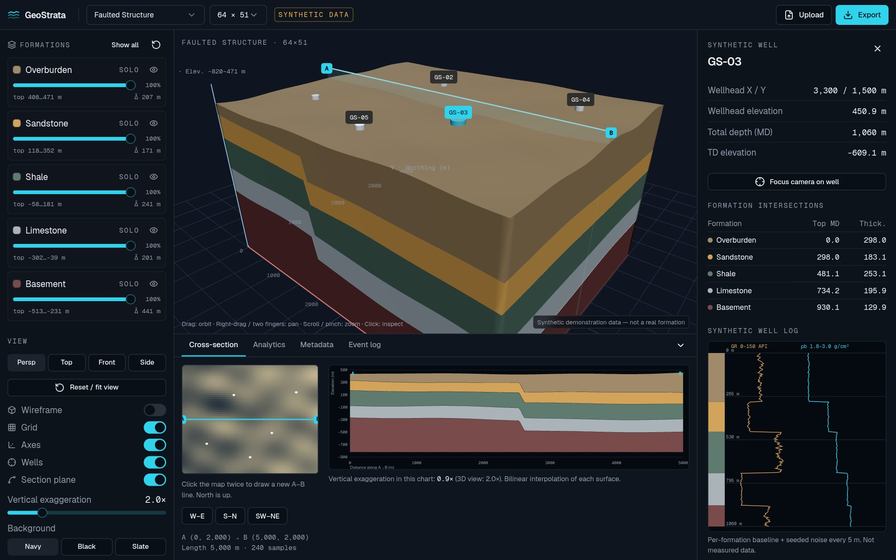

# GeoStrata — Interactive Subsurface Data Explorer

An independent geological visualization project inspired by my work integrating subsurface data with NVIDIA Omniverse and OpenUSD. Not affiliated with or endorsed by Halliburton or NVIDIA. **All bundled data is synthetic.**



## Features
- Three deterministic synthetic scenarios (Layered Basin, Folded Formations, Faulted Structure) at 32–128 grid resolution.
- One closed block mesh per formation (top, flipped base, outward side walls), indexed, CCW-wound.
- Picking, per-layer visibility/solo/opacity, wireframe, grid, axes, camera presets, vertical exaggeration.
- Five synthetic vertical wells per scenario with formation intersections and GR/density logs.
- Drawable A–B cross-section (bilinear interpolation, labelled axes, reported exaggeration).
- Analytics: thickness, relief, trapezoidal volume estimates, triangle counts.
- JSON/CSV upload with schema + semantic validation (kept in the browser).
- Export: JSON, CSV, PNG, GLB, OpenUSD `.usda` (validated with Pixar `usd-core`).

## Architecture
```
generateDataset / parseCsvDataset → validateDataset → zustand store
  ├─ formationBlock()  → BufferGeometry → R3F viewer
  ├─ deriveWell()      → wells, logs, inspector
  ├─ crossSection()    → SVG section
  ├─ formationStats()  → analytics
  └─ toJson / toCsv / toUsda / GLTFExporter
```
Domain logic lives in `src/lib/geo` (no React/three imports). UI in `src/components/explorer`.
World frame: X east, Y north, Z elevation, metres. The scene applies centre → scale (1 unit = 1 km, Z × exaggeration) → rotate into Y-up.

## Stack
React 19, TypeScript, TanStack Start, Tailwind v4, shadcn/ui, three.js, React Three Fiber, drei, Zod, Zustand, Recharts, Vitest.

## Development
```bash
bun install
bun run dev
bunx vitest run
```

## Data formats
See `/docs` in the app. JSON: `{ name, grid{nx,ny,x0,y0,dx,dy}, formations[], surfaces[] (formations+1, top→bottom, row-major z), wells? }`. CSV: `x,y,<surface…>` on a regular grid.

## Validating USD output
```bash
pip install usd-core
python scripts/validate_usda.py geostrata-layered-basin.usda
```

## Known limitations
Regular grids only; vertical wells only; synthetic logs; fault is a value offset, not a fault surface; volumes are geometric estimates; uploads are not persisted; WebGL transparency sorting is approximate. No backend or Python service is part of the app.

## Roadmap
Directional wells, scattered-point gridding, Web Worker meshing for large uploads, USD materials and variants.

## License & provenance
MIT. All datasets are generated by `src/lib/geo/generate.ts`; no real-world or proprietary data is included.
